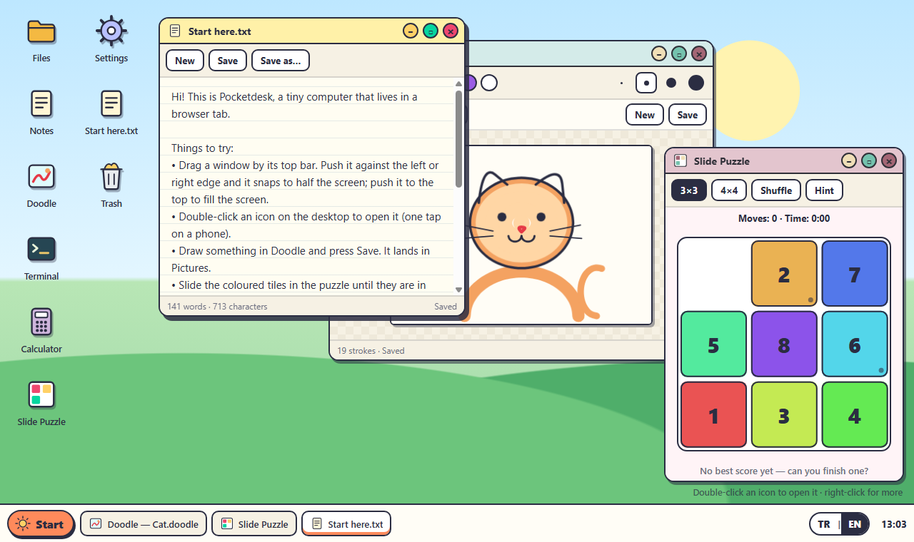

# Pocketdesk

Türkçe: [README.tr.md](README.tr.md)

Pocketdesk is a tiny make-believe computer that runs in a single web page: drag windows around, write notes, draw pictures, slide a puzzle, poke at files in a terminal, and find everything still there when you come back.



## Try it

Download or clone the folder and double-click `index.html`. That is all. There is nothing to install, no build step and no internet connection needed; every file the page uses sits in this folder.

The desk never opens empty. On first visit you get a welcome note, a drawing of a cat and a shuffled puzzle, plus a few sample files to rummage through. Everything you change is saved in your browser as you go.

The language follows your browser (Turkish if it starts with `tr`, English otherwise). Click **TR | EN** at the bottom right at any time to switch; the whole desk changes on the spot and remembers your choice.

## What is on the desk

| App | What you can do |
| --- | --- |
| **Files** | Browse folders, make new folders and notes, rename, duplicate, drag items into folders, throw things in the Trash and get them back. |
| **Notes** | A plain notepad. Once a note has a name it saves itself while you type. |
| **Doodle** | Draw with a mouse, pen or finger. Eight colours, four brush sizes, undo and redo. Drawings are saved as `.doodle` files in Pictures. |
| **Calculator** | Type or tap a sum and see the answer while you type. Understands `×`, `÷`, `%`, `√`, powers, factorials, `sin`/`cos`/`tan` in degrees or radians, and Turkish decimal commas (`3,5`). |
| **Slide Puzzle** | Put the coloured tiles in order on a 3×3 or 4×4 board. Stuck? The Hint button shows the next move. Best scores are kept. |
| **Terminal** | A small command line over the same files: `ls`, `cd`, `cat`, `echo hi > file.txt`, `mv`, `cp`, `rm`, `tree`, `open`, `calc` and more. Type `help`. |
| **Settings** | Language, four wallpapers, how much you have stored, and a "start over" button. |

### Moving windows around

- Drag a window by its top bar. Push it against the left or right edge to fill that half of the screen, or against the top to fill the whole screen. Drag it away again and it goes back to its old size.
- Drag any edge or corner to resize.
- Double-click the top bar to maximise or restore.
- The bar at the bottom lists every open window; click one to bring it forward or tuck it away.
- Right-click the desktop for new notes, drawings and folders, or to tile or stack all windows.
- Keyboard: `Alt+Shift+N` new note, `Alt+Shift+W` close the front window, `Alt+Shift+←/→` switch windows. Inside Files: arrows, `Enter`, `F2`, `Delete`, `Backspace`. In the terminal: `Tab` completes names, `↑`/`↓` bring back earlier commands.

On a phone every window opens full screen and a single tap opens icons.

## Terminal cheat sheet

```
help                     list every command
ls [folder]              what is in a folder
cd Documents             go into a folder (cd .. goes back up)
cat "Shopping list.txt"  print a file (quote names with spaces)
echo milk >> "Shopping list.txt"
mkdir -p a/b/c           make folders, including missing parents
mv old.txt new.txt       rename or move
cp Ideas.txt Copy.txt    copy (folders are copied whole)
rm -r Recipes            move to the Trash (again inside Trash: delete for good)
open Pictures/Cat.doodle open a file or folder in a window
calc 2^10 + 15%          quick sums
lang tr                  switch the desk to Turkish
```

Typos get a suggestion: `lss` answers "Did you mean ls?".

## How it works

The code is plain JavaScript split into three layers. Nothing in the core touches the page, so every core module can be loaded and tested on its own in Node.

```
js/core/      pure logic, no DOM
  vfs.js        file system: a flat table of nodes with parent links
  windows.js    window manager: placement, focus order, snapping, tiling, resize maths
  calc.js       calculator: tokenizer and recursive-descent parser (no eval)
  shell.js      terminal: quoting, redirection, commands, tab completion
  puzzle.js     slide puzzle: shuffling, solvability, IDA* solver for hints
  doodle.js     drawing documents: stroke simplification, safe decoding, rendering
  store.js      the single state container
  actions.js    every state change the app can make, in one place
  persist.js    saving to and loading from localStorage
  seed.js       the sample desk, built in the chosen language
  i18n.js       every piece of user-facing text, in Turkish and English
js/ui/        DOM helpers, desktop icons, window frames, taskbar
js/apps/      one file per app, each a mount() function
js/main.js    start-up: load or seed, wire the store to the UI, autosave
```

A few details that are worth knowing:

- **One-way data flow.** The UI never edits state directly. It calls `store.dispatch('fs/rename', {...})`; the matching handler in `actions.js` updates the state and names what changed (`fs`, `wm`, `lang`, ...). Subscribers redraw only what those topics touch.
- **Stable ids instead of paths.** Files are stored by id with a parent link, and paths are worked out on demand. Renaming a folder therefore never breaks an open window, and switching language can rename the built-in folders (Documents ↔ Belgeler) without anything noticing.
- **Dragging is cheap.** While a window is being dragged or resized only its CSS `transform` or size changes, at most once per animation frame. The state is updated once, when you let go.
- **The puzzle hint is a real solver.** IDA* with a Manhattan-distance heuristic that is updated incrementally and a board that is modified in place, so the search does not allocate per node. 3×3 boards are solved optimally (the hardest ones take 31 moves). A node budget keeps 4×4 hints responsive; if the budget runs out the hint falls back to the move that helps most right now.
- **Drawings stay small.** Each finished stroke is thinned with an iterative Ramer–Douglas–Peucker pass and rounded to one decimal place before it is saved.
- **Saved data is not trusted.** Loading checks that the file tree is consistent (every child exists, parent links agree, no cycles, everything reachable from the root). A damaged save is replaced by a fresh desk with a short notice, instead of a blank page.
- **A fresh desk follows the language.** If you have not changed anything yet and switch language, the sample files are rebuilt in the new language. Once you have made changes, only the built-in folder names are translated and your own files are left alone.

## Your data

Everything lives in your browser's `localStorage` under keys starting with `pocketdesk.` Nothing is sent anywhere. Clearing the site data in your browser, or pressing **Start over** in Settings, removes it. If the browser refuses to store anything (some private modes do), the desk still works and tells you that changes will not survive a reload.

## Running the tests

The tests use Node's built-in test runner, so no packages are needed (Node 22 or newer):

```
npm test
```

They cover the file system (paths, conflicts, moves into self, trash and restore, corrupted saves), the window manager (cascading, focus hand-over, clamping, resize anchors, snapping, tiling), the calculator (precedence, symbols, errors), the terminal (quoting, redirection, every command, completion), the puzzle (solvability, sliding rows, optimal solutions, the node budget), drawings (simplification, defensive decoding), the store and actions working together, saving and loading, and the translation tables, including a check that both languages have exactly the same keys and that every key used in the code exists.

## Limits

- It is a toy computer, not an emulator: there is no real operating system underneath, and apps are the ones listed above.
- Files are text only; each one is capped at about 400,000 characters and the whole desk at 5,000 items so the browser storage does not overflow.
- Dragging files between windows uses the browser's drag and drop, which most phones do not support. On a phone use the rename and trash buttons, or the terminal.

## License

MIT, see [LICENSE](LICENSE).
