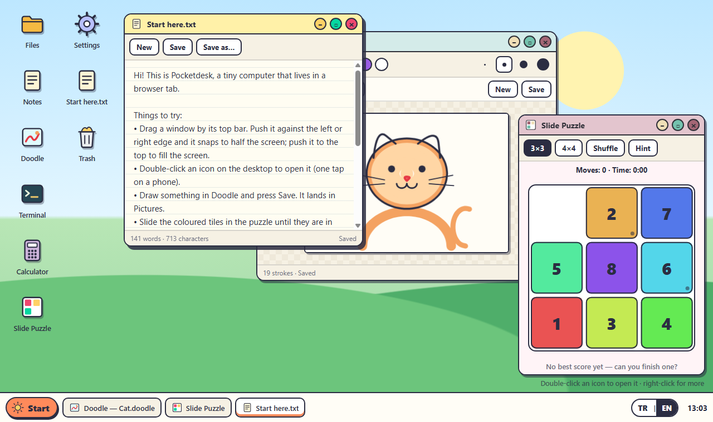

# Pocketdesk

In English: [README.md](README.md)

Pocketdesk, tek bir web sayfasında çalışan minik, oyuncak bir bilgisayar: pencereleri sürükle, not al, resim çiz, kaydırmalı bulmaca çöz, terminalden dosyaları kurcala; geri döndüğünde her şey bıraktığın yerde olsun.



## Hemen dene

Klasörü indir ya da klonla, sonra `index.html` dosyasına çift tıkla. Bu kadar. Kurulacak bir şey, derleme adımı ya da internet bağlantısı gerekmiyor; sayfanın kullandığı her dosya bu klasörün içinde.

Masa hiçbir zaman boş açılmaz. İlk girişte seni bir hoş geldin notu, bir kedi çizimi ve karıştırılmış bir bulmaca karşılar; karıştırmak için birkaç örnek dosya da hazırdır. Değiştirdiğin her şey sen çalıştıkça tarayıcına kaydedilir.

Dil tarayıcına göre seçilir (`tr` ile başlıyorsa Türkçe, değilse İngilizce). İstediğin an sağ alttaki **TR | EN** düğmesine tıklayarak dili değiştirebilirsin; bütün masa anında değişir ve seçimin hatırlanır.

## Masada neler var

| Uygulama | Neler yapabilirsin |
| --- | --- |
| **Dosyalar** | Klasörlerde gezin, yeni klasör ve not oluştur, yeniden adlandır, kopyala, öğeleri klasörlere sürükle, çöpe at ve geri getir. |
| **Notlar** | Sade bir not defteri. Bir kez adını koyduğun not, sen yazdıkça kendini kaydeder. |
| **Karalama** | Fareyle, kalemle ya da parmağınla çiz. Sekiz renk, dört fırça kalınlığı, geri al ve yinele. Çizimler Resimler klasörüne `.doodle` dosyası olarak kaydedilir. |
| **Hesap Makinesi** | İşlemi yaz ya da tuşlara bas; sonuç sen yazarken görünür. `×`, `÷`, `%`, `√`, üs, faktöriyel, derece ya da radyan cinsinden `sin`/`cos`/`tan` ve virgüllü ondalık (`3,5`) anlar. |
| **Kaydırmaca** | 3×3 ya da 4×4 tahtada renkli karoları sıraya diz. Takıldın mı? İpucu düğmesi sıradaki hamleyi gösterir. En iyi skorlar saklanır. |
| **Terminal** | Aynı dosyalar üzerinde çalışan küçük bir komut satırı: `ls`, `cd`, `cat`, `echo merhaba > dosya.txt`, `mv`, `cp`, `rm`, `tree`, `open`, `calc` ve dahası. `help` yaz. |
| **Ayarlar** | Dil, dört duvar kâğıdı, ne kadar şey sakladığın ve bir "baştan başla" düğmesi. |

### Pencereleri yönetmek

- Pencereyi üst çubuğundan tutup sürükle. Sol ya da sağ kenara dayarsan ekranın o yarısını, üst kenara dayarsan bütün ekranı kaplar. Geri çektiğinde eski boyutuna döner.
- Boyutlandırmak için herhangi bir kenarı ya da köşeyi sürükle.
- Üst çubuğa çift tıklamak ekranı kaplatır ya da eski hâline getirir.
- Alttaki çubukta açık pencerelerin hepsi durur; birine tıklarsan öne gelir ya da küçülür.
- Yeni not, çizim ve klasör için ya da bütün pencereleri döşemek, üst üste dizmek için masaüstüne sağ tıkla.
- Klavye: `Alt+Shift+N` yeni not, `Alt+Shift+W` öndeki pencereyi kapat, `Alt+Shift+←/→` pencereler arasında geç. Dosyalar'da: ok tuşları, `Enter`, `F2`, `Delete`, `Backspace`. Terminalde: `Tab` adları tamamlar, `↑`/`↓` önceki komutları getirir.

Telefonda her pencere tam ekran açılır ve simgeler tek dokunuşla açılır.

## Terminal için kısa not

```
help                     bütün komutları listele
ls [klasör]              klasörde neler var
cd Belgeler              klasöre gir (cd .. bir üste çıkar)
cat "Alışveriş listesi.txt"   dosyayı yaz (boşluklu adları tırnağa al)
echo süt >> "Alışveriş listesi.txt"
mkdir -p a/b/c           eksik ara klasörlerle birlikte oluştur
mv eski.txt yeni.txt     yeniden adlandır ya da taşı
cp Fikirler.txt Kopya.txt    kopyala (klasörler bütün hâlinde kopyalanır)
rm -r Tarifler           Çöp Kutusu'na at (çöpteyken tekrar: kalıcı sil)
open Resimler/Kedi.doodle    dosyayı ya da klasörü pencerede aç
calc 2^10 + 15%          hızlı hesap
lang en                  masayı İngilizceye çevir
```

Yazım hatalarına öneri gelir: `lss` yazarsan "Bunu mu demek istedin: ls?" diye sorar. `yardım` da `help` ile aynı işi görür.

## Nasıl çalışıyor

Kod düz JavaScript ve üç katmana ayrılmış durumda. Çekirdekteki hiçbir şey sayfaya dokunmaz; bu yüzden her çekirdek modülü Node içinde tek başına yüklenip test edilebilir.

```
js/core/      saf mantık, DOM yok
  vfs.js        dosya sistemi: ebeveyn bağlantılı düz bir düğüm tablosu
  windows.js    pencere yöneticisi: yerleşim, odak sırası, yapıştırma, döşeme, boyut hesapları
  calc.js       hesap makinesi: tokenizer ve özyinelemeli iniş parser'ı (eval yok)
  shell.js      terminal: tırnaklar, yönlendirme, komutlar, sekme tamamlama
  puzzle.js     bulmaca: karıştırma, çözülebilirlik, ipucu için IDA* çözücü
  doodle.js     çizim belgeleri: darbe sadeleştirme, güvenli okuma, çizim
  store.js      tek durum kabı
  actions.js    uygulamanın yapabileceği bütün durum değişiklikleri, tek yerde
  persist.js    localStorage'a kaydetme ve oradan yükleme
  seed.js       seçili dilde kurulan örnek masa
  i18n.js       kullanıcının gördüğü bütün metinler, Türkçe ve İngilizce
js/ui/        DOM yardımcıları, masaüstü simgeleri, pencere çerçeveleri, alt çubuk
js/apps/      her uygulama için bir dosya; her biri bir mount() fonksiyonu
js/main.js    açılış: yükle ya da örnek masayı kur, store'u arayüze bağla, otomatik kaydet
```

Bilmeye değer birkaç ayrıntı:

- **Tek yönlü veri akışı.** Arayüz durumu hiçbir zaman doğrudan değiştirmez. `store.dispatch('fs/rename', {...})` çağırır; `actions.js` içindeki ilgili işleyici durumu günceller ve neyin değiştiğini söyler (`fs`, `wm`, `lang`...). Aboneler yalnızca bu konuların ilgilendirdiği yeri yeniden çizer.
- **Yol yerine sabit kimlik.** Dosyalar kimlikle ve ebeveyn bağlantısıyla tutulur, yollar gerektiğinde hesaplanır. Bu sayede bir klasörü yeniden adlandırmak açık bir pencereyi bozmaz; dil değişince hazır klasörlerin adı da (Belgeler ↔ Documents) kimse fark etmeden değişebilir.
- **Sürüklemek ucuz.** Pencere sürüklenirken ya da boyutlandırılırken yalnızca CSS `transform` değeri ya da boyutu değişir, o da her animasyon karesinde en fazla bir kez. Durum, fareyi bıraktığında bir kez güncellenir.
- **Bulmaca ipucu gerçek bir çözücü.** Manhattan uzaklığını artımlı güncelleyen ve tahtayı yerinde değiştiren bir IDA*; arama sırasında düğüm başına bellek ayrılmaz. 3×3 tahtalar en kısa yoldan çözülür (en zorları 31 hamle). 4×4'te ipucunun gecikmemesi için bir düğüm bütçesi var; bütçe biterse ipucu o an en çok işe yarayan hamleyi gösterir.
- **Çizimler küçük kalır.** Biten her fırça darbesi kaydedilmeden önce özyinelemesiz bir Ramer–Douglas–Peucker geçişiyle inceltilir ve koordinatlar tek ondalığa yuvarlanır.
- **Kayıtlı veriye körü körüne güvenilmez.** Yüklerken dosya ağacının tutarlı olup olmadığına bakılır (her çocuk var mı, ebeveyn bağlantıları tutuyor mu, döngü var mı, her şeye kökten ulaşılabiliyor mu). Bozuk bir kayıt boş bir sayfa yerine kısa bir uyarıyla yeni bir masaya dönüşür.
- **Hiç dokunulmamış masa dile uyar.** Henüz hiçbir şey değiştirmeden dili değiştirirsen örnek dosyalar yeni dilde yeniden üretilir. Bir şeyler değiştirdikten sonra yalnızca hazır klasörlerin adları çevrilir, senin dosyalarına dokunulmaz.

## Verilerin

Her şey tarayıcının `localStorage` alanında, `pocketdesk.` ile başlayan anahtarlarda durur. Hiçbir şey hiçbir yere gönderilmez. Tarayıcıda site verilerini temizlemek ya da Ayarlar'daki **Baştan başla** düğmesine basmak bunları siler. Tarayıcı kayıt yapmaya izin vermezse (bazı gizli pencere modları böyledir) masa yine çalışır, ama değişikliklerin sayfa yenilenince kaybolacağını söyler.

## Testleri çalıştırmak

Testler Node'un yerleşik test aracını kullanır, yani hiçbir paket gerekmez (Node 22 ya da üstü):

```
npm test
```

Kapsananlar: dosya sistemi (yollar, ad çakışmaları, klasörü kendi içine taşıma, çöp ve geri getirme, bozuk kayıtlar), pencere yöneticisi (basamaklı yerleşim, odak devri, ekrana sığdırma, boyutlandırmada sabit kalan kenar, yapıştırma, döşeme), hesap makinesi (işlem önceliği, semboller, hatalar), terminal (tırnaklar, yönlendirme, bütün komutlar, tamamlama), bulmaca (çözülebilirlik, satır kaydırma, en kısa çözümler, düğüm bütçesi), çizimler (sadeleştirme, savunmacı okuma), store ile actions'ın birlikte çalışması, kaydetme ve yükleme, ve çeviri tabloları; iki dilde de tam olarak aynı anahtarların bulunduğunu ve kodda kullanılan her anahtarın var olduğunu denetleyen testler dahil.

## Sınırlar

- Bu bir oyuncak bilgisayar, emülatör değil: altında gerçek bir işletim sistemi yok, uygulamalar da yukarıdakilerden ibaret.
- Dosyalar yalnızca metin; tarayıcı deposu taşmasın diye her dosya yaklaşık 400.000 karakterle, bütün masa da 5.000 öğeyle sınırlı.
- Dosyaları pencereler arasında sürüklemek tarayıcının sürükle-bırak özelliğini kullanır; çoğu telefon bunu desteklemez. Telefonda yeniden adlandırma ve çöp düğmelerini ya da terminali kullanabilirsin.

## Lisans

MIT, bkz. [LICENSE](LICENSE).
